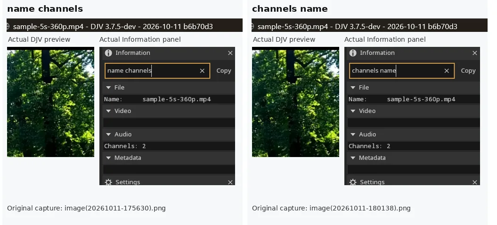
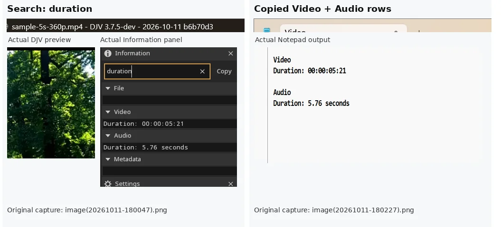
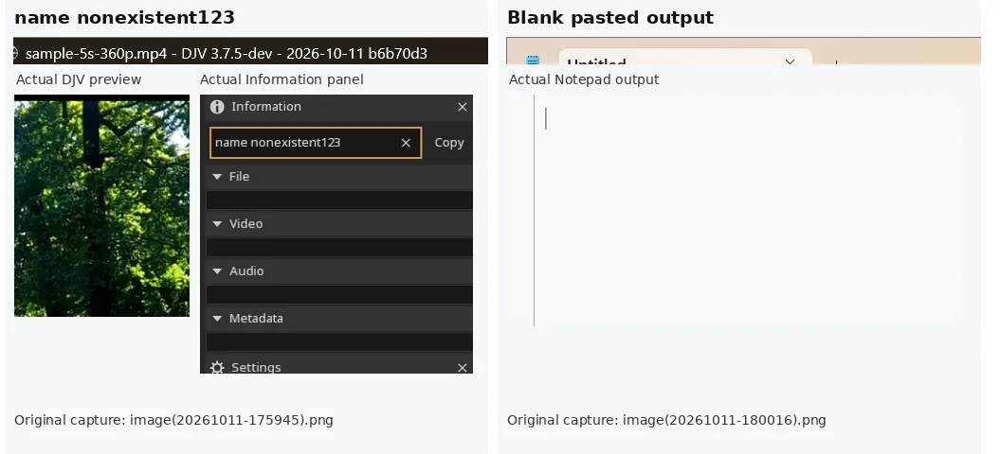
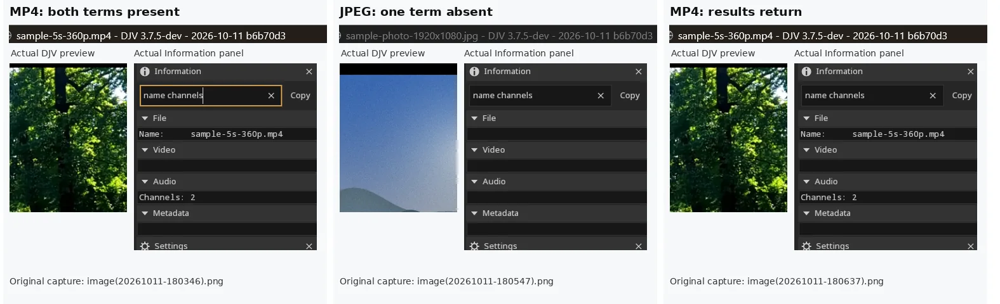
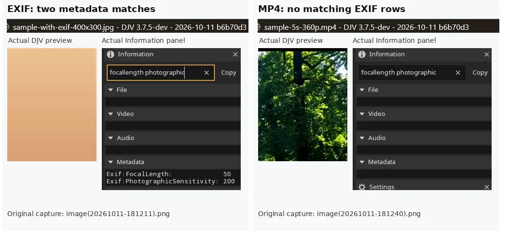

# PR #919 — current-head Windows GUI verification

Feature PR: https://github.com/grizzlypeak3d/DJV/pull/919  
Exact tested source commit: `b6b70d3fe1feb15cf2f9ebc9fa282979b8d68634`  
Evidence branch: `pr-919-evidence` (screenshots kept separate from feature code and CI)

## Results

- Windows Debug build passed at the exact commit.
- CTest: **1/1 top-level CTest targets passed; 17 internal test classes; 0 failures**, including Information search baseline and implied-AND classes.
- Exact-head fork push CI: 12 successful jobs; Linux/GLES3 CTest: 12/12 each. Upstream pull-request workflow still `action_required` and has **not run**.
- GUI cases passed: cross-section filtering; reversed terms; absent terms; both Duration fields; filtered and empty Copy; MP4/JPEG/EXIF media switching.
- Real EXIF data: `Exif:FocalLength = 50` and `Exif:PhotographicSensitivity = 200`; filtered Copy includes only these rows.
- Four selectable `Cubes.0001.exr` video layers: Combined, DiffCol, GlossDir, Normal.
- During EXR → JPEG → EXR with `type` query: `RGB F16 → RGB U8 → RGB F16`, with no persistent stale result or crash.
- Close All clears Information. A seeded PowerShell clipboard sentinel confirmed empty Copy **replaces** stale clipboard content.

## Current-head screenshots

### Real EXIF query

### Filtered EXIF Copy

### Four-layer EXR menu

### Pixel-type round trip

### Close All

### Clipboard sentinel

## Additional screenshots from earlier completed clean-head manual tests

These five panels juxtapose original captured screenshots from the same commit. They document **previously performed** checks; they do not represent newly executed tests.

### 17. Clean-head query word-order check

`name channels` and `channels name` both show File Name and Audio Channels on the same MP4.

### 18. Clean-head duplicate Duration and Copy

The `duration` query shows Video Duration and Audio Duration separately; the matching clipboard output contains those two sections.

### 19. Clean-head missing required term

`name nonexistent123` produces no visible Information rows; the accompanying Notepad screenshot shows blank pasted output. A separate clipboard sentinel conclusively tested clearing on Close All.

### 20. Clean-head MP4 to JPEG and back

With `name channels` kept active, MP4 matches, JPEG returns no rows under the provisional strict-AND behavior, and the MP4 rows return on switching back.

### 21. Clean-head EXIF to MP4 transition

`focallength photographic` matches two EXIF metadata rows on the JPEG; with the query unchanged, the MP4 displays no matching rows.

## Limits and pending decisions

- These are real manual GUI screenshots from a clean exact-head Windows build, **not** automated Information-panel screenshot tests.
- No persistent stale information or crash appeared in the tested states. A **transient** observer callback may still refresh before the new player's video-layer index is initialized. That timing has **not been directly instrumented or ruled out**.
- Cross-row implied-AND semantics, grouping of unquoted multiword labels, and any explicit `AND` syntax remain pending maintainer confirmation.
- Upstream PR workflow approval remains pending; the successful fork CI does not replace it.

Original PR description retains ten earlier screenshots separately as historical evidence.
